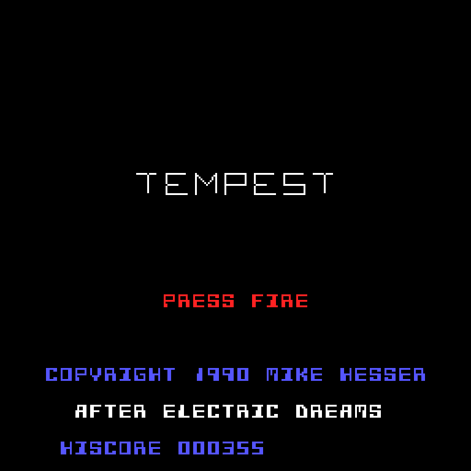
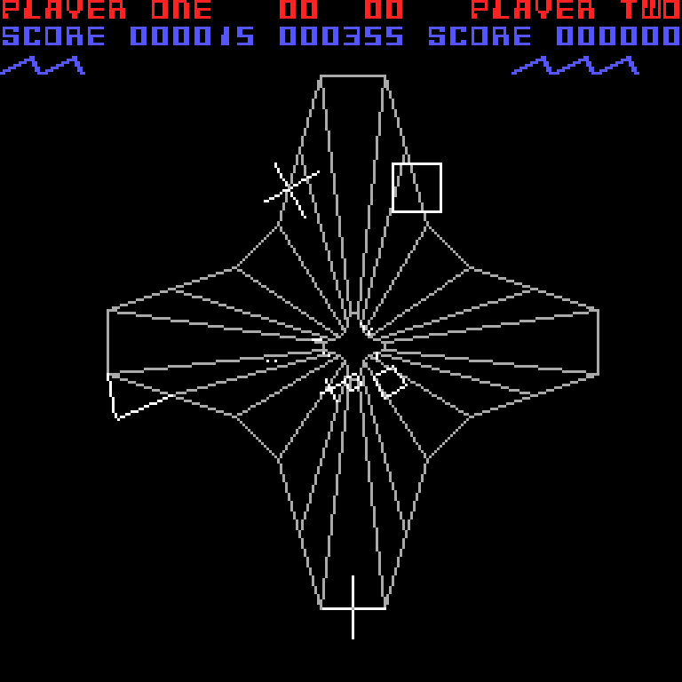

# AMIGA TEMPEST
written in 1990 by Mike Hesser in 68000 assembler for the Commodore Amiga, after the original of Electric Dreams

**Play it online: https://mikehesser.github.io/Amiga-Tempest/**

A version of the vector game Tempest. You move a claw-shaped "zapper" around the front rim of a tube and shoot
the enemies that crawl towards you through the lanes of the tube.

The program accesses the Amiga hardware directly: its own copper list, 256×256 pixels with 3 bitplanes, and all
lines are drawn by the blitter in XOR mode. The tube is calculated in 48 depth steps; each step moves 1/8 of the
remaining distance towards the vanishing point, which gives the perspective look.

## How to play

Open the link above, or download the repository and open `index.html` in a web browser. No installation required.

| Key | Function |
| --- | --- |
| `←` `→` | Move the zapper around the rim (joystick left / right) |
| `↑`, `Ctrl` or `Enter` | Fire (joystick button) |
| `Space` | Superzapper (once per level) |
| `Esc` | Back to the title screen |

On touch devices hold the left or right part of the screen to move, tap the middle to fire and the bottom middle
for the superzapper.

The enemies:

| Enemy | Behaviour | Points |
| --- | --- | --- |
| Flying X | rotates and comes closer every step | 20 |
| Crazy X | runs across the lanes, steps forward at the end of the tube | 50 |
| Square | rotates and comes closer every second step | 0 |
| Flipper | waits as a line across a lane, then flips over an edge into the next lane | 15 |
| Spike | grows towards the front and pulls back again | 25 |

An enemy that reaches the front rim in the lane of your zapper catches it. The superzapper sweeps through the tube
from front to back and destroys every enemy.

## About this version

The original program was never finished. It contains the three tube levels, the zapper, shots, the superzapper,
six types of enemies, the score display with its own bitmap font, a vector font with rotating texts ("TEMPEST",
"PLAYER ONE", "GAME OVER", "AVOID SPIKES") and the effects for building up and leaving a level.
The browser version takes all of this from the source code: level data, tables, fonts and the way enemies move.

What the original was still missing has been added in the spirit of Tempest:

* Losing a life, game over, moving on to the next level. After level 3 the levels repeat with more enemies,
  now also with Crazy X and spikes.
* A hit enemy disappears with a small explosion. In the original it stayed on the screen as a frozen picture.
* A shot also hits an enemy when both pass each other between two steps.
* The flipper flips faster than in the original.
* A title screen, a high score (stored in the browser) and touch controls.
* The speed of the main loop is an estimate of the timing on the Amiga.

## Files

| File | Description |
| --- | --- |
| `index.html` | The browser version (HTML/JavaScript, a single file) |
| `original/tempest2.s` | Original 68000 assembler source code (newer version) |
| `original/tempest.s` | Slightly older version of the source code |
