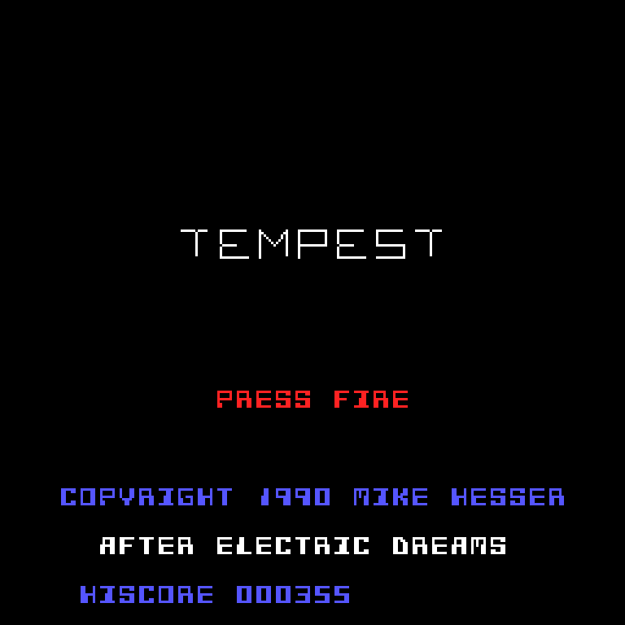
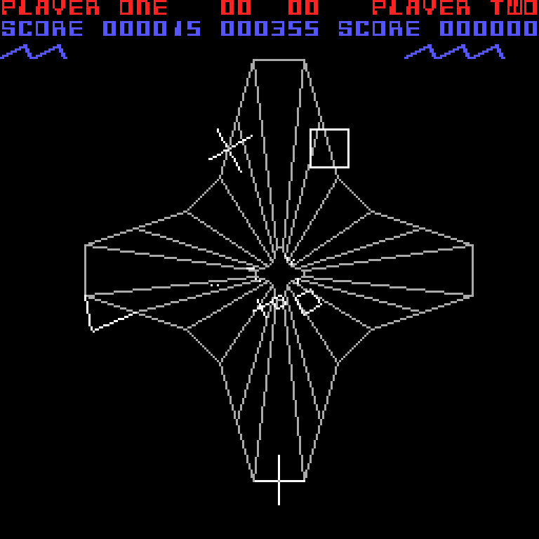

# AMIGA TEMPEST
geschrieben 1990 von Mike Hesser in 68000-Assembler für den Commodore Amiga, nach dem Original von Electric Dreams

**Online spielen: https://mikehesser.github.io/Amiga-Tempest/**

Eine Version des Vektorspiels Tempest. Man bewegt einen klauenförmigen „Zapper“ am vorderen Rand einer Röhre entlang
und schießt auf die Gegner, die durch die Bahnen der Röhre auf einen zukriechen.

Das Programm greift direkt auf die Amiga-Hardware zu: eigene Copperliste, 256×256 Pixel mit 3 Bitplanes, und alle
Linien zeichnet der Blitter im XOR-Modus. Die Röhre wird in 48 Tiefenstufen berechnet; jede Stufe rückt um 1/8 des
Restwegs auf den Fluchtpunkt zu, das ergibt die perspektivische Wirkung.

## Spielen

Den Link oben öffnen, oder das Repository herunterladen und `index.html` im Webbrowser öffnen. Keine Installation nötig.

| Taste | Funktion |
| --- | --- |
| `←` `→` | Zapper am Rand entlang bewegen (Joystick links / rechts) |
| `↑`, `Strg` oder `Enter` | Feuer (Joystick-Knopf) |
| `Leertaste` | Superzapper (einmal pro Level) |
| `Esc` | Zurück zum Titelbild |

Auf Touch-Geräten links oder rechts gedrückt halten zum Bewegen, in die Mitte tippen zum Feuern und unten in der Mitte
für den Superzapper.

Die Gegner:

| Gegner | Verhalten | Punkte |
| --- | --- | --- |
| Flying X | dreht sich und kommt jeden Schritt näher | 20 |
| Crazy X | läuft quer über die Bahnen, am Ende der Röhre einen Schritt nach vorne | 50 |
| Quadrat | dreht sich und kommt jeden zweiten Schritt näher | 0 |
| Flipper | wartet als Strich quer über einer Bahn und klappt dann über eine Kante in die Nachbarbahn | 15 |
| Spike | wächst nach vorne und zieht sich wieder zurück | 25 |

Ein Gegner, der in der Bahn des Zappers den vorderen Rand erreicht, erwischt ihn. Der Superzapper läuft von vorne nach
hinten durch die Röhre und vernichtet alle Gegner.

## Zu dieser Version

Das Originalprogramm wurde nie fertig. Es enthält die drei Röhren-Level, den Zapper, Schüsse, den Superzapper, sechs
Gegnerarten, die Punkteanzeige mit eigenem Raster-Zeichensatz, einen Vektor-Zeichensatz mit rotierenden Texten
(„TEMPEST“, „PLAYER ONE“, „GAME OVER“, „AVOID SPIKES“) und die Effekte für Aufbau und Verlassen eines Levels.
Die Browser-Version übernimmt all das aus dem Quelltext: Leveldaten, Tabellen, Zeichensätze und die Bewegung der Gegner.

Was dem Original noch fehlte, ist im Sinne von Tempest ergänzt:

* Leben verlieren, Game Over, Wechsel zum nächsten Level. Nach Level 3 wiederholen sich die Level mit mehr Gegnern,
  dann auch mit Crazy X und Spikes.
* Ein getroffener Gegner verschwindet mit einer kleinen Explosion. Im Original blieb er als eingefrorenes Bild stehen.
* Ein Schuss trifft auch dann, wenn Schuss und Gegner zwischen zwei Schritten aneinander vorbeiziehen.
* Der Flipper klappt schneller um als im Original.
* Ein Titelbild, ein Highscore (im Browser gespeichert) und Touch-Steuerung.
* Das Tempo der Hauptschleife ist dem Amiga-Timing nachempfunden.

## Dateien

| Datei | Beschreibung |
| --- | --- |
| `index.html` | Die Browser-Version (HTML/JavaScript, eine einzige Datei) |
| `original/tempest2.s` | Originaler 68000-Assembler-Quelltext (neuere Fassung) |
| `original/tempest.s` | Etwas ältere Fassung des Quelltexts |
